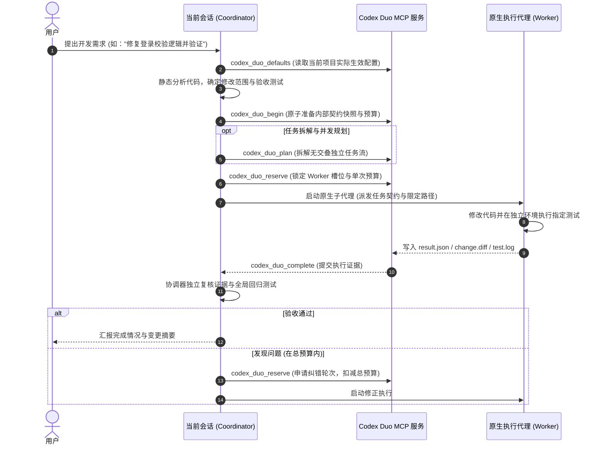

# Codex Duo

> **一个规划，一个执行** —— 面向 OpenAI Codex 的原生双模型 / 多代理协同开发系统。  
> 当前聊天负责任务规划与验收，原生执行代理（Worker）在受控边界与统一预算内高效交付代码。

[]()
[]()
[]()
[]()

---

## 目录

- [核心概念与设计理念](#核心概念与设计理念)
- [核心特性](#核心特性)
- [架构与协作流程](#架构与协作流程)
- [快速开始与安装](#快速开始与安装)
- [日常使用指南](#日常使用指南)
- [配置说明与分层机制](#配置说明与分层机制)
- [开发、构建与测试](#开发构建与测试)
- [仓库目录结构](#仓库目录结构)
- [安全边界与审计规范](#安全边界与审计规范)
- [版本演进概览](#版本演进概览)

---

## 核心概念与设计理念

Codex Duo 旨在解决大语言模型协同编码中的“规划发散”、“修改越界”、“配置繁琐”等痛点：

1. **分工明确（Coordinator & Worker）**：
   - **主控（Coordinator / 当前聊天）**：全面把控业务逻辑、接口契约、任务拆解与测试验收。
   - **执行代理（Worker）**：在分配的独立路径范围（`allowed_paths`）内专注于编写代码并生成测试证据，杜绝越界修改。
2. **一次配置，无感运行（Configure Once, Zero Friction）**：
   - 告别每次对话都要输入 slash command、手动复制任务 JSON 或反复指定模型与思考强度。
   - 项目一旦开启自动模式，日常提出开发需求（如“修复这个用例并完成验证”）即自动进入 Duo 协作流。
3. **全局默认与项目覆盖（Layered Settings）**：
   - 支持全局默认偏好，新项目自动继承；同时支持按项目单独覆盖（如特定项目要求不同执行模型或并行数）。
4. **受控并发与总预算账本（Bounded Parallelism & Durable Ledger）**：
   - 支持 1~3 个并行 Worker（根据宿主实际容量动态约束）。
   - 首次执行与后续修正轮次**严格共享父任务总轮数上限**，防止因修正死循环消耗过量 Token。
5. **绝对安全与零静默行为（Fail-Closed & Traceable）**：
   - 绝不静默替换模型，工具缺失即显式上报；
   - 问答、只读搜索、配置更新绝不唤起 Worker；
   - 不修改全局未授权配置，不自动提交 Git，不自动建立多余聊天。

---

## 核心特性

- **🚀 原生子代理派发**：基于 Codex 宿主内置的子代理能力执行，不依赖外挂不可控的外部命令行模型。
- **⚡ 智能并行协作**：支持独立文件的并行开发，依赖任务等待前序验证完成；对有冲突或交叠范围的任务严格拒绝拆分，保持单 Worker 串行执行。
- **📊 确定性契约与证据链**：每个子任务具备唯一的 `task.json` 契约，执行产生独立的 `diff`、`result.json` 及测试日志（保存在 `.codex-duo/evidence/`），确保每一步改动皆可追溯、可审计。
- **🖥️ 原生 macOS 菜单栏应用**：提供精致石墨外观的 SwiftUI 原生菜单栏面板（`Codex Duo.app`），无 Dock 栏干扰，随时切换全局/项目配置、查看当前配置生效来源。
- **🛡️ 冲突防护与原子更新**：所有配置采用带版本哈希（`revision`）的原子写入机制，并发修改冲突时拒绝覆盖并保留编辑草稿。

---

## 架构与协作流程

### 协作时序图



### 核心组件职责

| 组件 | 对应路径 | 核心职责 |
| :--- | :--- | :--- |
| **Codex 插件** | `plugins/codex-duo` | 提供本地 stdio MCP 服务，暴露 `codex_duo_defaults`、`codex_duo_begin`、`codex_duo_plan`、`codex_duo_reserve`、`codex_duo_complete`、`codex_duo_verify` 等核心接口；提供 `codex-duo` 规范技能。 |
| **macOS 菜单栏 App** | `macos/` | 基于 SwiftUI 的原生菜单栏应用，负责管理全局默认偏好与各项目独立设置，以无端口的 IPC 桥接安全通信。 |
| **设置与 Web 面板** | `panel/`, `native-build/` | 嵌入式与独立本地设置面板前端，提供直观的模型目录感知、推理强度校验及并行数设置。 |
| **工程测试套件** | `tests/` | 覆盖并发控制、状态隔离、契约约束、跨项目权限等多维度的自动化回归用例。 |

---

## 快速开始与安装

### 环境要求
- **操作系统**：macOS 14+ (Sonoma 或更高版本)
- **运行环境**：Python 3.11+、Node.js 18+ (用于构建面板 UI)、Swift 6+ (含 Xcode Command Line Tools)
- **客户端**：ChatGPT Desktop / Codex CLI (`/Applications/ChatGPT.app/Contents/Resources/codex-cli/bin/codex`)

### 1. 安装 Codex 插件

通过官方 CLI 将本地插件包添加至 Codex 环境：

```sh
# 添加本地插件
/Applications/ChatGPT.app/Contents/Resources/codex-cli/bin/codex plugin add codex-duo@codex-duo-local --json
```

### 2. 构建与运行 macOS 菜单栏应用

```sh
# 编译并生成 Codex Duo.app
bash macos/build.sh

# 打开菜单栏应用
open "macos/dist/Codex Duo.app"
```

> **提示**：应用启动后将在 macOS 顶部菜单栏显示双环图标。可点击查看或编辑当前项目及全局默认偏好。

### 3. 项目启用与配置

1. **图形界面配置**：在菜单栏应用中选择目标项目，设置 Worker 模型（如 `gpt-6.1-sol` 或 `gpt-6-luna`）、推理强度（`high` / `medium` / `low`）、最大执行轮数（如 `3` 或 `10`）以及最大并行代理数（`1` / `2` / `3`）。
2. **启用自动化流程**：将模式设置为 `automatic_project`（项目自动）并保存。保存时会自动在项目的 `AGENTS.md` 中写入如下受控指令块：

```markdown
<!-- codex-duo:begin -->
## Codex Duo project workflow

For user-requested implementation or bug fixes, load the `codex-duo` skill and read
`codex_duo_defaults` with the actual current chat project directory as `project_root`.
...
<!-- codex-duo:end -->
```

---

## 日常使用指南

### 1. 日常开发任务（全自动）

在已启用 Codex Duo 的项目中，你无需使用任何特殊前缀或 Slash Command，直接描述具体开发需求即可：

- *“帮我为用户注册模块补充单元测试，并验证覆盖率。”*
- *“修复订单超时未取消的 bug，并跑通关联测试用例。”*

**Coordinator 将自动完成**：
1. 静默读取已保存的项目/全局配置；
2. 分析代码并拟定执行契约；
3. 调度底层 Worker 完成实现；
4. 复核测试与 Diff 证据后直接向你汇报结果。

### 2. 只读查询与对话（零开销保护）

当你的请求属于以下情况时，系统**绝对不会**启动 Worker 模型，避免产生额外消耗：
- 询问架构或代码含义（如 *“解释一下 `codex_duo_service.py` 的作用”*）；
- 只读检查（如 *“搜索项目中是否有用到 asyncio”*）；
- 明确要求不启动模型（如 *“先给我出个方案，不要写代码”*）；
- 修改或查看系统配置。

### 3. 查看与更新配置

随时对主控说：
- *“打开 Codex Duo 配置”*
或直接点击 macOS 顶部菜单栏的双环图标。任何保存的配置更新将即时对后续任务生效，而正在运行中的任务将严格维持原快照配置。

---

## 配置说明与分层机制

### 配置解析层级

```text
[当前项目覆盖: <project_root>/.codex-duo/selection.json]
                     │
                     ▼ (未配置时自动继承)
[全局默认配置: ~/.codex/codex-duo/selection.json]
                     │
                     ▼ (初次未配置)
[引导状态: setup-required (需要初始化配置)]
```

- **项目覆盖优先**：项目级配置完全独立，清除项目覆盖时系统会自动备份历史，恢复继承全局默认。
- **只读安全**：读取和在不同项目间切换**永远不落盘**，绝不产生隐藏写入。

### 核心配置项解析 (`selection.json`)

```json
{
  "workflow": {
    "activation": "automatic_project",
    "coordinator_mode": "current_thread",
    "max_worker_turns": 10,
    "max_parallel_workers": 1
  },
  "worker": {
    "model": "gpt-6.1-sol",
    "reasoning_effort": "high"
  },
  "coordinator": {
    "mode": "current_thread",
    "selected_model": null
  }
}
```

| 字段 | 类型 | 候选值 / 默认值 | 作用说明 |
| :--- | :--- | :--- | :--- |
| `workflow.activation` | string | `automatic_project` \| `manual` | 激活方式。`automatic_project` 自动介入；`manual` 需显式呼叫 Codex Duo。 |
| `workflow.coordinator_mode` | string | `current_thread` | 主控运行模式。当前会话作为规划与验收主控。 |
| `workflow.max_worker_turns` | integer | 默认 `10` (建议 3~10) | 单个任务的**总 Worker 执行预算上限**（所有并行子任务及修正共享）。 |
| `workflow.max_parallel_workers` | integer | `1` \| `2` \| `3` (默认 `1`) | 允许的最大并发 Worker 数。实际并发受宿主容量严格制约。 |
| `worker.model` | string | 本地目录支持的模型名 | 执行代理采用的模型（如 `gpt-6.1-sol`、`gpt-6-luna` 等）。 |
| `worker.reasoning_effort` | string | `low` \| `medium` \| `high` | 执行代理的思考强度级别。 |

---

## 开发、构建与测试

本仓库提供了端到端严格的自动化验证机制，覆盖协议契约、并发调度与原生打包：

```sh
# 1. 运行完整 Python 单元测试 (120+ 项协议与工作流测试)
python3 -B -m unittest discover -s tests -v

# 2. 运行 Swift 原生模块测试
swift test --package-path macos

# 3. 运行静态代码与合规检查
python3 -B tools/validate_static.py

# 4. 构建与测试前端面板
node native-build/build.mjs
node native-build/test-panel.mjs
node native-build/test-client.mjs

# 5. 打包 macOS 菜单栏应用
bash macos/build.sh
```

---

## 仓库目录结构

```text
codex-duo/
├── macos/                     # macOS 原生 SwiftUI 菜单栏应用源码 (Swift 6+)
│   ├── Sources/               # 菜单栏应用主体、UI 视图与 Python IPC 桥接
│   ├── Tests/                 # Swift 单元测试
│   └── build.sh               # 编译与 .app 打包脚本
├── plugins/
│   └── codex-duo/        # Codex 插件主目录 (本地 stdio MCP)
│       ├── mcp/               # MCP 协议服务端入口与跨平台启动器 (launch.sh)
│       ├── skills/
│       │   ├── codex-duo/     # 规范技能定义 (SKILL.md)
│       │   └── codex-duo/        # 工作流契约、调度核心脚本与模板
│       └── plugin.json        # 插件元数据与能力声明清单
├── panel/                     # 嵌入式与独立本地 Web 设置面板
├── native-build/              # 前端编译脚本、测试客户端与打包管线
├── tests/                     # 自动化测试套件 (包含全局默认、并发账本、项目隔离等)
├── tools/                     # 静态验证脚本与本地测试 Harness
├── AGENTS.md                  # 项目内管理的 Codex Duo 自动化工作流说明
└── NATIVE-INSTALL.md          # 详细本地安装与更新排错备忘录
```

---

## 安全边界与审计规范

1. **严禁越界与静默替换**：
   - MCP 服务本身**不直接执行外部命令、不直接启动大模型**。所有模型执行全部交由 Codex 官方宿主审计与调度。
   - 宿主工具不支持已配置的模型或思考强度时，系统必须明确告知用户并降级至主控独立会话，严禁私自替换模型。
2. **严防代码篡改**：
   - Worker 只能修改其所签署契约（`contract.md`）中的 `allowed_paths`。
   - 所有的代码变动均生成独立的 `change.diff`，并要求主控在合并前重新独立验证。
3. **环境与配置零污染**：
   - 不修改全局 shell profile；
   - 不静默写入 `~/.codex/config.toml`；
   - 切换项目或读取配置不产生任何磁盘副作用。

---

## 版本演进概览

- **v0.9.8（当前插件版本）**：修正详情页与输入示例的 logo / composerIcon 资源路径前缀；应用仍为 0.9.7 / build 16，页面显示待重载后确认。
- **v0.9.7**：插件与应用图标从标题栏原 SVG 统一生成，包含完整 ICNS 尺寸与 PNG 引用。
- **v0.9.6**：移除手动验收与唤醒专用流程，主对话等待结果并验收；保留 Planner、原生 Worker、通用终态、diff 证据链及界面修复。
- **v0.9.5**：明确 Worker canonical diff 契约，提供范围绑定的 snapshot/diff/verify 命令，新增/删除证据与诊断回归。
- **v0.9.4**：原生设置头部固定独立图标占位，窄宽及长状态文案自适应；设置与完成流程不变。
- **v0.9.1**：澄清旧式 prepare 与当前 begin 的区别，提供 coordinator_required 的具体原因与恢复步骤，保留快照和预算保护。

- **v0.9.0**：
  - 引入受控多 Worker 并行能力（`max_parallel_workers` 可选 1 / 2 / 3）；
  - 实现持久化父任务执行账本，首次派发与所有修正严格共享 `max_worker_turns` 总预算；
  - 完善冲突范围检测，交叠或不确定依赖的任务强制保持单 Worker 安全调度。
- **v0.4.0**：
  - 支持分层配置（全局默认 + 项目独立覆盖）；
  - 引入 `automatic_project` 模式与 `AGENTS.md` 自动化受控引导块；
  - 强化主控职责为当前会话，避免无意义的聊天创建。
- **v0.3.x**：
  - 引入本地 stdio MCP 服务；
  - 解决受限 PATH 下的 Python 3.11+ 运行时探测与兼容性包装；
  - 达成官方 MCP 客户端协议互通。
- **v0.2.0 - v0.1.0**：
  - 确立“一个规划、一个执行”的核心交互范式；
  - 建立离线任务契约、证据收集与测试验证流水线原型。

## 可选：独立只读规划代理（Plan only，第一版）

现在可以单独配置规划模型与强度，让其提出计划，再回到**当前聊天**由你确认。
这不会切换当前聊天模型，也不改变原有 Worker 执行链或 `selected_model` 的含义。
旧配置默认关闭；在原生菜单、Web 面板或插件设置中打开“独立规划代理”，选择模型、强度和
1–3 次总规划预算，然后明确要求“只规划”。保存配置不会启动模型。

### 官方独立只读会话

当前聊天可通过插件建立独立 Local 规划会话，不再依赖自定义角色选择。它使用官方 app-server
接口，并在模型启动前核对实际只读、网络禁用、approval never、模型与强度响应，禁用继承的
MCP、插件、apps、hooks 和递归代理。配置或权限不匹配时直接阻断，不降级为 Worker。
保存设置不收费；明确启动规划会产生所选模型调用费用，结果回当前聊天确认。

正常使用：保存规划偏好后，在当前聊天说 **“只规划：你的目标，不执行”**。
也可以明确批准单次模型、强度和预算，保持默认关闭；协调者内部准备契约，用户无需拼 JSON。
可在聊天要求“查询规划状态”或“停止规划”。现有会话可能需要刷新技能/工具，但不会自动重启应用。

### 入口与结果

`codex_duo_planner_begin → planner_run → planner_status` 是独立会话路径；`planner_stop` 请求停止。
所有调用必须显式提供当前项目 `project_root`。请求包括 schema_version=1、task_id、goal、
read_paths、questions；只接受项目内明确的相对文件路径，可指向尚未创建的文件。
适配器传入这些文件的有限 UTF-8 内容和独立输出 schema，不让模型自己填写权限证明。
结果为摘要、步骤、风险、待确认问题与建议测试，建议测试一律 not_run。Planner 不测试、
不构建、不写代码或结果文件、不批准实施、不启动 Worker；结果由父层保存并校验。

会话/回执、有效权限、预算和 turn 发出意图持久化；重复 attempt_id 只读原状态。
发出模型 turn 后失败也不自动重试或换模型；超时、连接断开或进程丢失会保持不确定派发，
禁止再启动以免重复计费。预检失败的尝试也保守占用任务尝试预算，状态标注 turn 未发出。
独立会话不改变当前聊天模型。原 planner_reserve/complete 保留为兼容原生宿主入口；
自定义 codex_duo_planner 配置可用于那条链，但不再是独立会话的前置要求。
详见[宿主说明](plugins/codex-duo/skills/workflow/references/planner-host.md)。

新增 workflow 字段：

- `planner_mode`: `disabled`（默认）或 `plan_only`
- `planner_model`、`planner_reasoning_effort`: 独立规划模型及目录支持的强度
- `max_planner_turns`: 1–3，默认 1；失败与重试也计入总预算

模型、配置版本、输入与代码基线在任务创建时固定；同一 task_id 重开或服务重启不会重置预算。
代码基线覆盖 Git HEAD、索引和跟踪/非忽略未跟踪文件的内容哈希，也包括明确指定的忽略文件。
`.codex-duo` 内部状态不计入代码基线。拒绝部分常见凭据命名（如 `.env`、`.aws`、`.ssh`、私钥后缀），但这不是秘密检测保证；
仅在已清理秘密的代码工作树使用。符号链接、子模块、无提交或非根目录仓库
暂不支持。上限为 20,000 个文件、每文件 32 MiB、合计 128 MiB；超限直接阻断，不声称部分扫描完整。
计划期间代码变化使结果失效；这不是对并发编辑的原子快照，应在稳定工作树使用。
状态哈希用于发现意外变动，不是面对可改写全部状态文件的攻击者的认证机制。

### 你确认后怎么执行

这一版刻意没有“规划后自动执行”。计划先回到当前聊天。你明确批准实施后，协调者重新检查
`planner_status` 的代码基线和实际计划内容，将已批准范围转成原有普通 Worker 任务，继续
`codex_duo_begin → plan → reserve → complete → verify`。计划 ID 不能作为执行交接 ID；
规划契约不能进入 Worker。计划本身、设置开关和 Planner 声称已批准都不构成实施授权。

开发验证新增 `tests/test_planner.py` 和 `tests/test_planner_configuration.py`，覆盖能力门禁、
模型失败、预算/重启、并发派发、哈希篡改、基线变化、重复结果及设置兼容。新增
`tests/test_planner_session.py` 验证官方会话协议、预检阻断、唯一派发、失联和停止；离线 fixture
不证明真实模型执行，真实验收另存官方会话响应与模型回执。

名称迁移（0.9.0）：活动插件为 `codex-duo@codex-duo-local`，MCP 为 `codex-duo`，工具统一 `codex_duo_` 前缀，项目状态为 `.codex-duo`。旧状态须使用 `python3 -B plugins/codex-duo/skills/workflow/scripts/codex_duo_workflow.py migrate --project-root <项目绝对路径>` 显式迁移；它原样移动配置、预算和会话记录，重复执行不变，冲突时停止。旧文件名仅用于迁移识别，不注册旧工具或角色。全局 `CODEX_HOME/codex-duo` 模型偏好不变。

### 结果返回与验收

主对话等待原生 Worker 完成，记录真实回执并验证证据，再独立检查修改和测试后报告结果。独立规划代理仍只读，计划返回主对话确认，不自动执行。完成不等于验收通过；未知、失败、取消不能冒称完成。

已移除手动验收完成列表、复制提示与后台唤醒实验。旧设置读取统一按 return，读取不会写盘；授权迁移只更改保存的完成模式，保留模型、预算、项目覆盖和历史记录。不会修补旧 failed 证据或把余额当成重试授权。

### 当前聊天执行入口与旧交接

正常执行顺序是 `codex_duo_defaults → codex_duo_begin → codex_duo_plan → codex_duo_reserve → 原生 Worker → complete → verify`。
`prepare` 是旧式声明交接入口，缺少工作流字段，不能直接进入 `plan/reserve`。
`execution_plan` 只读检查交接资格；`plan` 建立子任务与容量计划，两者都不启动规划模型。
若误用了 `prepare`，确认同一任务从未保留或派发后，保留旧交接，用其原始 task（含相同 task_id）调用 `begin`。
新快照包含工作流，所以 ID 会不同；已有预算不能通过新任务重置。`selected_model` 的原快照仍须按其主控约束处理。
请求级字段不会覆盖主控方式，保存的模型选择也不能证明实际聊天模型身份。

### Worker diff 证据（0.9.5）

`reserve.evidence_commands` 提供明确的改前 `snapshot_before_edit`、改后 `diff_after_edit`、保存真实测试日志/result.json 后的 `preflight_result`。主控应原样传给 Worker，改前必须捕获当前实际字节；不用 Git HEAD，也不扫描整份脏 diff。输出为 `--- a/<项目相对文件>` / `+++ b/<同一文件>`，新增/删除只在缺失的一侧使用 `/dev/null`。临时、未跟踪、非 Git 文件只要处于项目内明确 allowed_paths 就支持；缺基线、已有输出、二进制、符号链接、重命名元数据和仅空文件新增/删除会明确拒绝。完整命令和示例见插件 `skills/workflow/references/contract.md`。预检只检查格式、范围与证据哈希，不证明代码验收通过、不启动模型、不授予重试权限；失败的历史 Worker 记录不修补、不重提 complete。
