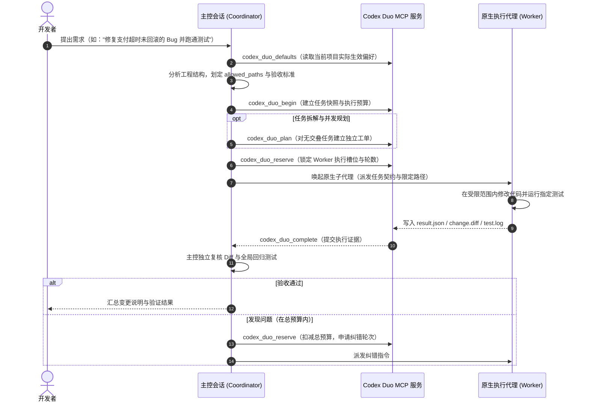

# Codex Duo

> **一个规划，一个执行** —— 面向 OpenAI Codex 的原生双代理协同开发系统。  
> 主控会话负责任务拆解与代码验收，原生子代理在受控边界与预算内高效交付代码。

[]()
[]()
[]()
[]()
[]()

---

## 目录

- [为什么需要 Codex Duo](#为什么需要-codex-duo)
- [核心设计理念](#核心设计理念)
- [工作原理与协作流程](#工作原理与协作流程)
- [核心功能特性](#核心功能特性)
- [快速开始](#快速开始)
  - [环境准备](#环境准备)
  - [1. 安装 Codex 本地插件](#1-安装-codex-本地插件)
  - [2. 构建并运行菜单栏应用](#2-构建并运行菜单栏应用)
  - [3. 启用项目](#3-启用项目)
- [日常使用指南](#日常使用指南)
  - [日常编码与修复（全自动）](#日常编码与修复全自动)
  - [独立技术规划（只规划不编码）](#独立技术规划只规划不编码)
  - [普通技术咨询（零开销保护）](#普通技术咨询零开销保护)
- [配置说明与分层机制](#配置说明与分层机制)
  - [配置生效层级](#配置生效层级)
  - [配置项详述 (`selection.json`)](#配置项详述-selectionjson)
- [工程结构与本地开发](#工程结构与本地开发)
  - [目录结构](#目录结构)
  - [构建与测试](#构建与测试)
- [安全边界与审计保障](#安全边界与审计保障)
- [常见问题 (FAQ)](#常见问题-faq)

---

## 为什么需要 Codex Duo

在大模型辅助编码（AI Pair Programming）中，传统的单一模型对话往往存在以下痛点：

1. **越界修改与连锁破坏**：模型在修改一个函数时，容易擅自重构不相干的文件或模块，导致测试崩溃且难以回滚。
2. **反复配置与心智负担**：每次开启新任务都需要重复强调上下文、规则，或者手动输入复杂的 Slash Command 与参数。
3. **纠错死循环与预算失控**：执行出错时，模型可能陷入无休止的自我修改循环，迅速耗尽 Token 额度。
4. **并发风险与状态冲突**：多任务并行时，缺乏明确的文件归属与契约约束，导致文件写入冲突与代码丢失。

**Codex Duo** 引入**“主控规划（Coordinator）+ 原生子代理执行（Worker）”**的双角色架构，将业务理解、契约制定与实际代码落地解耦，让 AI 协作开发既敏捷又高度可控。

---

## 核心设计理念

- **分工明确（Coordinator & Worker）**：
  - **Coordinator（当前主聊天会话）**：全面负责需求理解、代码分析、任务拆解、路径范围界定以及最终测试验收。
  - **Worker（原生子代理）**：在受限文件列表（`allowed_paths`）内专注于编写代码与执行测试，提供可审计的修改证据。
- **一次配置，无感运行（Configure Once, Zero Friction）**：
  保存项目偏好后，日常提出开发需求（如“修复订单超时逻辑并补充测试”）自动进入 Duo 工作流，无需反复指定模型与参数。
- **分层配置与安全继承（Layered Configuration）**：
  提供“全局默认配置”与“项目级独立覆盖”。新项目开箱即用继承全局设置，重点项目亦可随时独立微调。
- **严格预算与并发控制（Bounded Budget & Concurrency）**：
  每个任务具备持久化总执行轮数（Turn Budget），初次执行与后续纠错共享上限；支持 1~3 个 Worker 安全并发执行互不依赖的任务。
- **只读保护与独立规划（Plan-only Mode）**：
  日常技术问答、方案探讨、只读搜索绝不触发 Worker 开销；支持可选的独立规划模式，先由高阶模型输出技术方案，待你确认后再决定是否实施。

---

## 工作原理与协作流程

### 协作时序图



### 证据闭环机制

每次 Worker 执行均会在 `.codex-duo/evidence/` 下留存完整的交付物：
- **`contract.md` / `task.json`**：该子任务的明确目标、限定修改路径（`allowed_paths`）与验收标准。
- **`change.diff`**：针对目标文件的标准改动对比，严格拒绝范围外的文件写入。
- **`result.json` & `test.log`**：执行状态与测试套件运行的原始日志。

主控只有在独立复核证据哈希并确认集成测试通过后，才会向开发者确认任务完成。

---

## 核心功能特性

| 特性 | 说明 |
| :--- | :--- |
| **原生代理调度** | 基于 Codex 内置子代理机制调度，无需外挂不可控的外部 CLI 进程。 |
| **确定性范围限制** | 严格限定 Worker 的写入路径，避免对非相关文件造成意外污染。 |
| **智能并行协作** | 支持 1~3 个 Worker 并发处理互不影响的独立文件；有依赖或交叠的任务保持安全串行。 |
| **总预算账本** | 任务执行与纠错共享统一的最大轮数（`max_worker_turns`），防止失控陷入无休止循环。 |
| **独立规划模式** | 可配置专门的模型与推理强度生成只读实施计划，经用户确认后再启动代码编写。 |
| **macOS 菜单栏应用** | 原生轻量 SwiftUI 菜单栏应用（双环图标），直观切换全局与项目设置，感知生效状态。 |
| **零开销日常保护** | 只读问答、方案咨询、配置查看自动保持单会话解答，绝不浪费 Worker 额度。 |

---

## 快速开始

### 环境准备

- **操作系统**：macOS 14+ (Sonoma 或更高版本)
- **Python**：3.11+
- **Node.js**：18+（用于构建面板 UI）
- **Swift**：6.0+（自带 Xcode Command Line Tools 即可）
- **Codex 宿主**：ChatGPT Desktop / Codex CLI

### 1. 安装 Codex 本地插件

将本地插件注册到 Codex 宿主中：

```sh
# 添加本地插件 marketplace
/Applications/ChatGPT.app/Contents/Resources/codex-cli/bin/codex plugin marketplace add "$(pwd)"

# 安装 codex-duo 本地插件
/Applications/ChatGPT.app/Contents/Resources/codex-cli/bin/codex plugin add codex-duo@codex-duo-local --json
```

### 2. 构建并运行菜单栏应用

Codex Duo 包含一个用于便捷管理配置的原生 macOS 菜单栏应用：

```sh
# 编译并生成 Codex Duo.app
bash macos/build.sh

# 打开菜单栏应用
open "macos/dist/Codex Duo.app"
```

> **提示**：启动后，macOS 顶部菜单栏会出现双环图标。点击即可快速切换当前项目或修改全局偏好。

### 3. 启用项目

在菜单栏应用中选择当前代码仓库目录，将工作流模式切换为 **`automatic_project`（项目自动）** 并保存。

系统会在项目根目录的 `AGENTS.md` 中写入自动化受控指令：

```markdown
<!-- codex-duo:begin -->
## Codex Duo project workflow

For user-requested implementation or bug fixes, load the `codex-duo` skill and read
`codex_duo_defaults` with the actual current chat project directory as `project_root`.
...
<!-- codex-duo:end -->
```

完成配置后，当前项目即可自动享受双代理协同开发。

---

## 日常使用指南

### 轻任务与本次 Worker 覆盖

现有设置界面新增“轻任务”预设：Worker 为 `gpt-6-luna / low`，当前聊天规划验收，
不额外启动 Planner。选择只填入草稿；点击保存才修改所选范围的默认，已有预设和设置保留。

只想临时使用时，在聊天说：**“这次用 Luna low，完成后下次仍用默认。”**
协调者通过实际 `codex_duo_begin` 参数传入
`worker_override={"model":"gpt-6-luna","reasoning_effort":"low"}`，不调用保存设置。
也支持只指定一个字段，按“本次显式值 > 项目配置 > 全局默认”合并后校验；非法组合直接拒绝，
不自动调整模型或强度。下一新任务省略覆盖即可恢复默认。

本次选择与逐字段来源写入不可变任务快照；同一 `task_id` 重复请求复用快照与预算，
任务或覆盖参数冲突明确拒绝。设置变更和服务重启不会改变旧任务。
聊天任务摘要分别显示请求值、成功派发参数、宿主实际返回的运行时值；宿主未返回字段显示“未提供”。
配置、代理 ID 和离线测试都不能独立证明实际运行模型。更新插件后须重新核对当前聊天工具 schema；
旧 begin 不支持覆盖时应更新并重开聊天，再进行真实验收。

### 日常编码与修复（全自动）

在已启用 Codex Duo 的项目中，你无需输入任何前缀或特殊指令，像平常一样直接提出开发需求：

```text
“帮我给用户登录模块补充 JWT 过期刷新的单元测试，并验证通过。”
“修复订单金额计算中浮点数精度丢失的 Bug，并跑通关联测试用例。”
```

**主控与 Worker 的协同过程**：
1. **自动识别**：主控读取当前项目配置，确定 Worker 模型、思考强度与轮数预算。
2. **任务划定**：主控静态分析代码，圈定修改文件范围与测试验证命令。
3. **后台执行**：唤起 Worker 原生子代理在隔离范围内编写代码与运行测试。
4. **独立验收**：主控核验修改 Diff 与测试日志，确认无误后向你汇报最终结果。

### 独立技术规划（只规划不编码）

如果你希望在动手前先梳理大型重构方案，或者只想让高推理模型出具实施步骤：

1. 在菜单栏设置中开启 **独立规划代理（Plan-only）**，指定规划模型（如高推理模型）与预算（1~3 轮）。
2. 在对话中明确提出规划需求：
   ```text
   “只规划：重构鉴权模块并支持 OAuth2，先出技术方案，不要写代码。”
   ```
3. 系统将通过受限的只读会话输出步骤分析、风险评估与测试建议。在你审阅并明确确认实施前，不会对代码进行任何改动。

### 普通技术咨询（零开销保护）

当你的提问属于以下类型时，系统会自动以普通对话形式直接回答，**绝对不会**启动 Worker：
- 代码逻辑解析（如 *“解释一下 `server.py` 中 MCP 路由的处理流程”*）
- 项目内代码检索或语法咨询（如 *“找一下工程里所有的自定义 Exception”*）
- 显式要求仅出思路（如 *“先帮我分析下方案优缺点，先不要写代码”*）
- 查看或更新系统配置

---

## 配置说明与分层机制

### 配置生效层级

Codex Duo 采用分层继承机制，确保灵活性与整洁度：

```text
┌──────────────────────────────────────────────────────────┐
│  项目覆盖配置: <project_root>/.codex-duo/selection.json   │  优先读取
└────────────────────────────┬─────────────────────────────┘
                             │ (未配置时自动继承)
                             ▼
┌──────────────────────────────────────────────────────────┐
│  全局默认偏好: ~/.codex/codex-duo/selection.json           │  全局生效
└──────────────────────────────────────────────────────────┘
```

- **项目覆盖优先**：项目级配置完全独立。当清除项目配置时，系统会自动切回继承全局默认。
- **纯粹无副作用**：只读查询或在不同项目之间切换浏览**绝不写入磁盘**。

### 配置项详述 (`selection.json`)

```json
{
  "workflow": {
    "activation": "automatic_project",
    "coordinator_mode": "current_thread",
    "max_worker_turns": 10,
    "max_parallel_workers": 1,
    "planner_mode": "disabled",
    "planner_model": null,
    "planner_reasoning_effort": "high",
    "max_planner_turns": 1
  },
  "worker": {
    "model": "gpt-6.1-sol",
    "reasoning_effort": "high"
  },
  "coordinator": {
    "mode": "current_thread",
    "selected_model": null
  }
}
```

| 字段 | 类型 | 可选值 / 说明 |
| :--- | :--- | :--- |
| `workflow.activation` | `string` | `automatic_project`（满足条件自动启用，推荐） \| `manual`（需显式呼叫） |
| `workflow.coordinator_mode` | `string` | `current_thread`（当前会话担任主控协调者） |
| `workflow.max_worker_turns` | `integer` | Worker 执行总轮数上限（默认 `10`，首次派发与后续纠错共享该预算） |
| `workflow.max_parallel_workers` | `integer` | 最大并发 Worker 数量（可选 `1` / `2` / `3`，默认 `1`） |
| `worker.model` | `string` | 执行代理所使用的模型（如 `gpt-6.1-sol`、`gpt-6-luna` 等） |
| `worker.reasoning_effort` | `string` | 执行代理的思考强度（`low` / `medium` / `high`） |
| `workflow.planner_mode` | `string` | 独立规划模式：`disabled`（默认关闭） \| `plan_only`（开启只读规划） |
| `workflow.planner_model` | `string` | 规划代理所使用的模型 |
| `workflow.planner_reasoning_effort`| `string` | 规划代理思考强度（`low` / `medium` / `high`） |
| `workflow.max_planner_turns` | `integer` | 规划最大轮数（可选 `1` ~ `3`，默认 `1`） |

---

## 工程结构与本地开发

### 目录结构

```text
codex-duo/
├── macos/                     # macOS 原生 SwiftUI 菜单栏应用源码 (Swift 6+)
│   ├── Sources/               # 菜单栏应用主体、界面与 IPC 桥接
│   ├── Tests/                 # Swift 单元测试
│   └── build.sh               # 编译打包脚本
├── plugins/
│   └── codex-duo/             # Codex 本地插件主目录 (本地 stdio MCP)
│       ├── mcp/               # MCP 协议服务端入口与跨平台启动脚本
│       ├── skills/            # 规范技能定义与调度核心脚本
│       └── plugin.json        # 插件元数据与能力声明清单
├── panel/                     # 嵌入式与独立本地设置面板前端
├── native-build/              # 前端编译脚本、测试客户端与构建管线
├── tests/                     # 完整的自动化测试套件 (覆盖并发、状态隔离、契约约束等)
├── tools/                     # 静态验证脚本与本地调试工具
├── AGENTS.md                  # 项目内管理的自动化工作流配置说明
└── NATIVE-INSTALL.md          # 本地安装与更新排错备忘录
```

### 构建与测试

本仓库具备严格的自动化测试用例，覆盖协议契约、并发控制、配置迁移与桌面打包：

```sh
# 1. 运行完整 Python 单元测试 (200+ 项测试)
python3.11 -B -m unittest discover -s tests -v

# 2. 运行 Swift 原生模块测试
swift test --package-path macos

# 3. 构建前端设置面板
node native-build/build.mjs
node native-build/test-panel.mjs

# 4. 重新构建 macOS 菜单栏应用
bash macos/build.sh
```

---

## 安全边界与审计保障

1. **严格的路径白名单与 Diff 审查**：
   Worker 只能在主控签署的 `allowed_paths` 范围内修改代码。所有改动均生成独立的 Canonical Diff，且在主控合并复核前不视为交付。
2. **宿主安全隔离与免静默降级**：
   MCP 服务自身不盲目越权执行外部不受信命令。若宿主不支持配置的模型或思考强度，系统会向开发者明确说明，绝不静默替换模型。
3. **环境与配置零污染**：
   - 绝不擅自修改全局 Shell 配置文件；
   - 绝不自动执行未获授权的 `git commit` 或 `git push`；
   - 切换项目或读取配置绝不在磁盘产生无意义的脏数据。

---

## 常见问题 (FAQ)

#### Q: 为什么需要一个独立的 macOS 菜单栏应用？
菜单栏应用常驻在屏幕右上角（石墨质感双环图标），不占用 Dock 栏，能让你随时查看当前项目生效的配置层级、快速切换目标工程、调整 Worker 模型与并发数，直观方便。

#### Q: Worker 在修改代码时会动到其他文件吗？
不会。主控在派发任务时会明确指定 `allowed_paths`，Worker 仅在指定的文件范围内执行编辑。在合并时，主控会核验变更 Diff 与实际测试日志，确保没有越界改动。

#### Q: 我只是想让 AI 帮我解释一段代码，会唤起 Worker 扣费吗？
不会。对于代码解释、只读搜索、架构咨询或配置查看等请求，主控直接在当前会话中快速解答，完全不会创建任何任务或启动 Worker。

#### Q: 如果测试失败或代码有 Bug，系统会无限重试吗？
不会。每个任务都有严格的 `max_worker_turns`（总轮数预算）。首次执行与后续的修正轮次共享这本账，一旦超出预算将立即停止并如实向你报告未完成项，绝不陷入死循环。

---

<p align="center">
  <b>Codex Duo</b> · 让大模型协同编码严谨、高效、可追溯。
</p>
