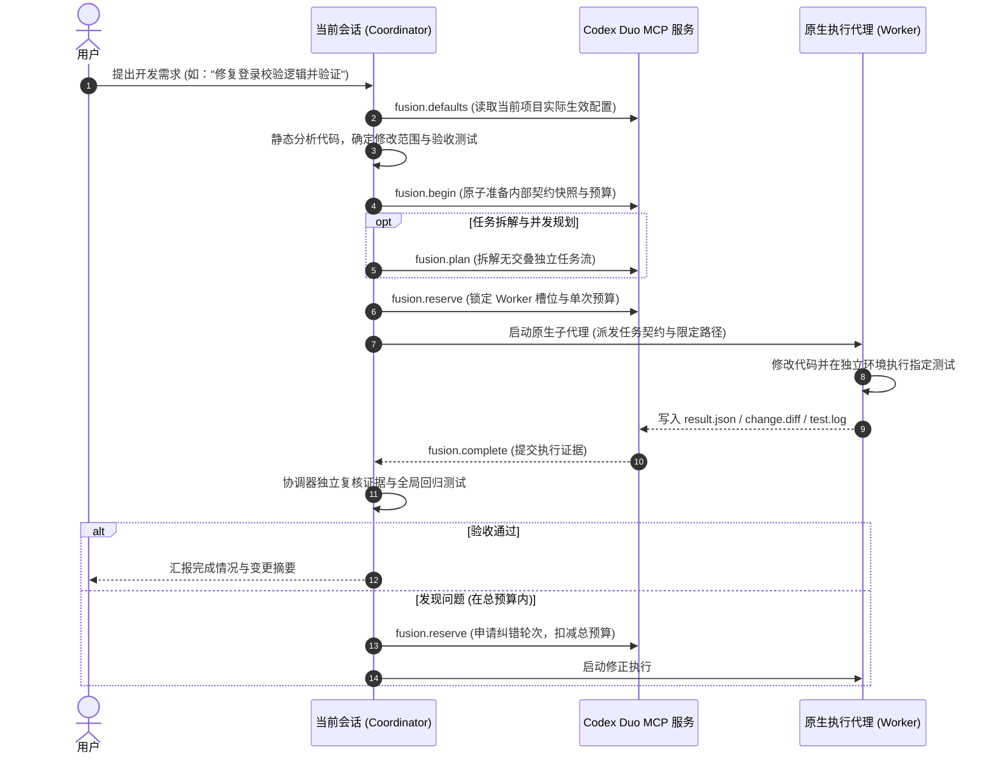

# Codex Duo

> **一个规划，一个执行** —— 面向 OpenAI Codex 的原生双模型 / 多代理协同开发系统。  
> 当前聊天负责任务规划与验收，原生执行代理（Worker）在受控边界与统一预算内高效交付代码。

[]()
[]()
[]()
[]()

---

## 目录

- [核心概念与设计理念](#核心概念与设计理念)
- [核心特性](#核心特性)
- [架构与协作流程](#架构与协作流程)
- [快速开始与安装](#快速开始与安装)
- [日常使用指南](#日常使用指南)
- [配置说明与分层机制](#配置说明与分层机制)
- [开发、构建与测试](#开发构建与测试)
- [仓库目录结构](#仓库目录结构)
- [安全边界与审计规范](#安全边界与审计规范)
- [版本演进概览](#版本演进概览)

---

## 核心概念与设计理念

Codex Duo 旨在解决大语言模型协同编码中的“规划发散”、“修改越界”、“配置繁琐”等痛点：

1. **分工明确（Coordinator & Worker）**：
   - **主控（Coordinator / 当前聊天）**：全面把控业务逻辑、接口契约、任务拆解与测试验收。
   - **执行代理（Worker）**：在分配的独立路径范围（`allowed_paths`）内专注于编写代码并生成测试证据，杜绝越界修改。
2. **一次配置，无感运行（Configure Once, Zero Friction）**：
   - 告别每次对话都要输入 slash command、手动复制任务 JSON 或反复指定模型与思考强度。
   - 项目一旦开启自动模式，日常提出开发需求（如“修复这个用例并完成验证”）即自动进入 Duo 协作流。
3. **全局默认与项目覆盖（Layered Settings）**：
   - 支持全局默认偏好，新项目自动继承；同时支持按项目单独覆盖（如特定项目要求不同执行模型或并行数）。
4. **受控并发与总预算账本（Bounded Parallelism & Durable Ledger）**：
   - 支持 1~3 个并行 Worker（根据宿主实际容量动态约束）。
   - 首次执行与后续修正轮次**严格共享父任务总轮数上限**，防止因修正死循环消耗过量 Token。
5. **绝对安全与零静默行为（Fail-Closed & Traceable）**：
   - 绝不静默替换模型，工具缺失即显式上报；
   - 问答、只读搜索、配置更新绝不唤起 Worker；
   - 不修改全局未授权配置，不自动提交 Git，不自动建立多余聊天。

---

## 核心特性

- **🚀 原生子代理派发**：基于 Codex 宿主内置的子代理能力执行，不依赖外挂不可控的外部命令行模型。
- **⚡ 智能并行协作**：支持独立文件的并行开发，依赖任务等待前序验证完成；对有冲突或交叠范围的任务严格拒绝拆分，保持单 Worker 串行执行。
- **📊 确定性契约与证据链**：每个子任务具备唯一的 `task.json` 契约，执行产生独立的 `diff`、`result.json` 及测试日志（保存在 `.fusion/evidence/`），确保每一步改动皆可追溯、可审计。
- **🖥️ 原生 macOS 菜单栏应用**：提供精致石墨外观的 SwiftUI 原生菜单栏面板（`Codex Duo.app`），无 Dock 栏干扰，随时切换全局/项目配置、查看当前配置生效来源。
- **🛡️ 冲突防护与原子更新**：所有配置采用带版本哈希（`revision`）的原子写入机制，并发修改冲突时拒绝覆盖并保留编辑草稿。

---

## 架构与协作流程

### 协作时序图



### 核心组件职责

| 组件 | 对应路径 | 核心职责 |
| :--- | :--- | :--- |
| **Codex 插件** | `plugins/fusion-minimal` | 提供本地 stdio MCP 服务，暴露 `fusion.defaults`、`fusion.begin`、`fusion.plan`、`fusion.reserve`、`fusion.complete`、`fusion.verify` 等核心接口；提供 `codex-duo` 规范技能。 |
| **macOS 菜单栏 App** | `macos/` | 基于 SwiftUI 的原生菜单栏应用，负责管理全局默认偏好与各项目独立设置，以无端口的 IPC 桥接安全通信。 |
| **设置与 Web 面板** | `panel/`, `native-build/` | 嵌入式与独立本地设置面板前端，提供直观的模型目录感知、推理强度校验及并行数设置。 |
| **工程测试套件** | `tests/` | 覆盖并发控制、状态隔离、契约约束、跨项目权限等多维度的自动化回归用例。 |

---

## 快速开始与安装

### 环境要求
- **操作系统**：macOS 14+ (Sonoma 或更高版本)
- **运行环境**：Python 3.11+、Node.js 18+ (用于构建面板 UI)、Swift 6+ (含 Xcode Command Line Tools)
- **客户端**：ChatGPT Desktop / Codex CLI (`/Applications/ChatGPT.app/Contents/Resources/codex-cli/bin/codex`)

### 1. 安装 Codex 插件

通过官方 CLI 将本地插件包添加至 Codex 环境：

```sh
# 添加本地插件
/Applications/ChatGPT.app/Contents/Resources/codex-cli/bin/codex plugin add fusion-minimal@fusion-local --json
```

### 2. 构建与运行 macOS 菜单栏应用

```sh
# 编译并生成 Codex Duo.app
bash macos/build.sh

# 打开菜单栏应用
open "macos/dist/Codex Duo.app"
```

> **提示**：应用启动后将在 macOS 顶部菜单栏显示双环图标。可点击查看或编辑当前项目及全局默认偏好。

### 3. 项目启用与配置

1. **图形界面配置**：在菜单栏应用中选择目标项目，设置 Worker 模型（如 `gpt-6.1-sol` 或 `gpt-6-luna`）、推理强度（`high` / `medium` / `low`）、最大执行轮数（如 `3` 或 `10`）以及最大并行代理数（`1` / `2` / `3`）。
2. **启用自动化流程**：将模式设置为 `automatic_project`（项目自动）并保存。保存时会自动在项目的 `AGENTS.md` 中写入如下受控指令块：

```markdown
<!-- codex-duo:begin -->
## Codex Duo project workflow

For user-requested implementation or bug fixes, load the `codex-duo` skill and read
`fusion.defaults` with the actual current chat project directory as `project_root`.
...
<!-- codex-duo:end -->
```

---

## 日常使用指南

### 1. 日常开发任务（全自动）

在已启用 Codex Duo 的项目中，你无需使用任何特殊前缀或 Slash Command，直接描述具体开发需求即可：

- *“帮我为用户注册模块补充单元测试，并验证覆盖率。”*
- *“修复订单超时未取消的 bug，并跑通关联测试用例。”*

**Coordinator 将自动完成**：
1. 静默读取已保存的项目/全局配置；
2. 分析代码并拟定执行契约；
3. 调度底层 Worker 完成实现；
4. 复核测试与 Diff 证据后直接向你汇报结果。

### 2. 只读查询与对话（零开销保护）

当你的请求属于以下情况时，系统**绝对不会**启动 Worker 模型，避免产生额外消耗：
- 询问架构或代码含义（如 *“解释一下 `fusion_service.py` 的作用”*）；
- 只读检查（如 *“搜索项目中是否有用到 asyncio”*）；
- 明确要求不启动模型（如 *“先给我出个方案，不要写代码”*）；
- 修改或查看系统配置。

### 3. 查看与更新配置

随时对主控说：
- *“打开 Codex Duo 配置”*
或直接点击 macOS 顶部菜单栏的双环图标。任何保存的配置更新将即时对后续任务生效，而正在运行中的任务将严格维持原快照配置。

---

## 配置说明与分层机制

### 配置解析层级

```text
[当前项目覆盖: <project_root>/.fusion/selection.json]
                     │
                     ▼ (未配置时自动继承)
[全局默认配置: ~/.codex/codex-duo/selection.json]
                     │
                     ▼ (初次未配置)
[引导状态: setup-required (需要初始化配置)]
```

- **项目覆盖优先**：项目级配置完全独立，清除项目覆盖时系统会自动备份历史，恢复继承全局默认。
- **只读安全**：读取和在不同项目间切换**永远不落盘**，绝不产生隐藏写入。

### 核心配置项解析 (`selection.json`)

```json
{
  "workflow": {
    "activation": "automatic_project",
    "coordinator_mode": "current_thread",
    "max_worker_turns": 10,
    "max_parallel_workers": 1
  },
  "worker": {
    "model": "gpt-6.1-sol",
    "reasoning_effort": "high"
  },
  "coordinator": {
    "mode": "current_thread",
    "selected_model": null
  }
}
```

| 字段 | 类型 | 候选值 / 默认值 | 作用说明 |
| :--- | :--- | :--- | :--- |
| `workflow.activation` | string | `automatic_project` \| `manual` | 激活方式。`automatic_project` 自动介入；`manual` 需显式呼叫 Codex Duo。 |
| `workflow.coordinator_mode` | string | `current_thread` | 主控运行模式。当前会话作为规划与验收主控。 |
| `workflow.max_worker_turns` | integer | 默认 `10` (建议 3~10) | 单个任务的**总 Worker 执行预算上限**（所有并行子任务及修正共享）。 |
| `workflow.max_parallel_workers` | integer | `1` \| `2` \| `3` (默认 `1`) | 允许的最大并发 Worker 数。实际并发受宿主容量严格制约。 |
| `worker.model` | string | 本地目录支持的模型名 | 执行代理采用的模型（如 `gpt-6.1-sol`、`gpt-6-luna` 等）。 |
| `worker.reasoning_effort` | string | `low` \| `medium` \| `high` | 执行代理的思考强度级别。 |

---

## 开发、构建与测试

本仓库提供了端到端严格的自动化验证机制，覆盖协议契约、并发调度与原生打包：

```sh
# 1. 运行完整 Python 单元测试 (120+ 项协议与工作流测试)
python3 -B -m unittest discover -s tests -v

# 2. 运行 Swift 原生模块测试
swift test --package-path macos

# 3. 运行静态代码与合规检查
python3 -B tools/validate_static.py

# 4. 构建与测试前端面板
node native-build/build.mjs
node native-build/test-panel.mjs
node native-build/test-client.mjs

# 5. 打包 macOS 菜单栏应用
bash macos/build.sh
```

---

## 仓库目录结构

```text
codex-duo/
├── macos/                     # macOS 原生 SwiftUI 菜单栏应用源码 (Swift 6+)
│   ├── Sources/               # 菜单栏应用主体、UI 视图与 Python IPC 桥接
│   ├── Tests/                 # Swift 单元测试
│   └── build.sh               # 编译与 .app 打包脚本
├── plugins/
│   └── fusion-minimal/        # Codex 插件主目录 (本地 stdio MCP)
│       ├── mcp/               # MCP 协议服务端入口与跨平台启动器 (launch.sh)
│       ├── skills/
│       │   ├── codex-duo/     # 规范技能定义 (SKILL.md)
│       │   └── fusion/        # 工作流契约、调度核心脚本与模板
│       └── plugin.json        # 插件元数据与能力声明清单
├── panel/                     # 嵌入式与独立本地 Web 设置面板
├── native-build/              # 前端编译脚本、测试客户端与打包管线
├── tests/                     # 自动化测试套件 (包含全局默认、并发账本、项目隔离等)
├── tools/                     # 静态验证脚本与本地测试 Harness
├── AGENTS.md                  # 项目内管理的 Codex Duo 自动化工作流说明
└── NATIVE-INSTALL.md          # 详细本地安装与更新排错备忘录
```

---

## 安全边界与审计规范

1. **严禁越界与静默替换**：
   - MCP 服务本身**不直接执行外部命令、不直接启动大模型**。所有模型执行全部交由 Codex 官方宿主审计与调度。
   - 宿主工具不支持已配置的模型或思考强度时，系统必须明确告知用户并降级至主控独立会话，严禁私自替换模型。
2. **严防代码篡改**：
   - Worker 只能修改其所签署契约（`contract.md`）中的 `allowed_paths`。
   - 所有的代码变动均生成独立的 `change.diff`，并要求主控在合并前重新独立验证。
3. **环境与配置零污染**：
   - 不修改全局 shell profile；
   - 不静默写入 `~/.codex/config.toml`；
   - 切换项目或读取配置不产生任何磁盘副作用。

---

## 版本演进概览

- **v0.7.0（当前版本）**：
  - 引入受控多 Worker 并行能力（`max_parallel_workers` 可选 1 / 2 / 3）；
  - 实现持久化父任务执行账本，首次派发与所有修正严格共享 `max_worker_turns` 总预算；
  - 完善冲突范围检测，交叠或不确定依赖的任务强制保持单 Worker 安全调度。
- **v0.4.0**：
  - 支持分层配置（全局默认 + 项目独立覆盖）；
  - 引入 `automatic_project` 模式与 `AGENTS.md` 自动化受控引导块；
  - 强化主控职责为当前会话，避免无意义的聊天创建。
- **v0.3.x**：
  - 引入本地 stdio MCP 服务；
  - 解决受限 PATH 下的 Python 3.11+ 运行时探测与兼容性包装；
  - 达成官方 MCP 客户端协议互通。
- **v0.2.0 - v0.1.0**：
  - 确立“一个规划、一个执行”的核心交互范式；
  - 建立离线任务契约、证据收集与测试验证流水线原型。
